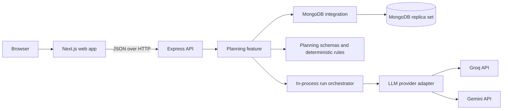

# 2. System and Component Architecture

## 2.1 Runtime view



The browser calls only the API. It never connects to MongoDB or an LLM provider. The API
owns validation, generation, run state, and version commits.

## 2.2 Ownership and dependency direction

```text
HTTP route -> controller -> planning service -> validator
                                      |       -> planning repository contract
                                      |       -> LLM provider contract
                                      v
                                MongoDB repository adapter
                                LLM provider adapter
```

- **Route:** declares paths and composes the planning controller.
- **Controller:** parses HTTP inputs, calls application operations, validates response
  envelopes, and maps status codes.
- **Planning service:** owns project/run/version use cases and coordinates the pipeline.
- **Planning validation:** owns the complete-plan schema, plan invariants, coverage checks,
  technical payload/entity-size safety limits, and deterministic dependency ordering. New
  generated plans may contain at most ten Features.
- **Web plan projection:** displays at most the first ten Features in stored order and only
  their descendant Stories/Tasks. It leaves the complete immutable backend version intact.
- **Planning repository:** feature-owned persistence contract consumed by the service.
- **MongoDB adapter:** owns Mongoose models, indexes, queries, transactions, and connection
  mechanics. Feature services do not import Mongoose.
- **LLM provider contract:** accepts the complete-plan request and returns untrusted JSON.
- **LLM adapter:** owns Groq/Gemini HTTP/SDK details, timeout, response parsing, and safe
  error normalization.
- **Bootstrap:** constructs dependencies and registers features. It does not own planning
  behavior or response business rules.
- **Shared types:** only public contracts used by both web and API belong in
  `packages/types`. Runtime validation stays with the API feature unless a second runtime
  genuinely consumes that schema.

Use functional factories and explicit immutable dependencies. Do not add a DI container,
global mutable provider, or speculative role directories. Keep the planning feature flat
until a code category owns a real independent boundary.

## 2.3 Process and startup lifecycle

1. Read and validate API environment configuration.
2. Construct logger, MongoDB integration, provider adapter (if configured), repository,
   planning service, Express app, and HTTP server.
3. Connect to MongoDB and verify transaction capability before enabling generation/version
   writes.
4. Mark abandoned active runs interrupted; enqueue persisted queued runs into the in-process
   runner without duplicate claims.
5. Start accepting HTTP traffic only after mandatory startup checks succeed.
6. On shutdown, stop new HTTP traffic, allow bounded in-flight work to finish or persist its
   interruption, then close MongoDB and the server.

The current boot path connects MongoDB and resumes queued runs before `server.start()`. The
transaction-capability check is an explicit hardening requirement; the current code detects
unsupported transactions when committing and must be improved to fail readiness/startup
clearly.

## 2.4 Lightweight deployment boundary

V1 is one Next.js process plus one API process and MongoDB. Generation runs inside the API
process but are persisted before execution. MongoDB provides durable run records and
transactional version commits. No queue service, cache, agent framework, or separate worker
is required. If volume later exceeds single-process capacity, introduce a queue only with a
measured throughput/recovery requirement and a separate architecture decision.
