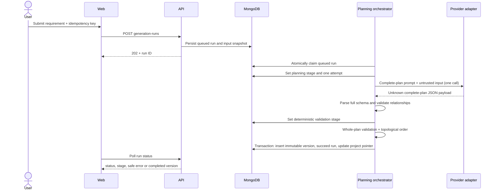
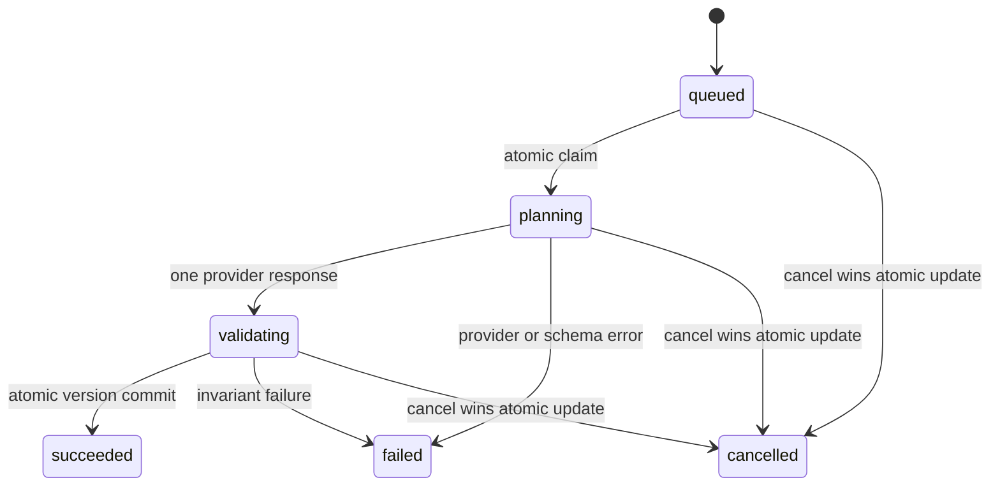

# 3. Generation Workflow and Run State Machine

## 3.1 Sequence

Provider output is always `unknown` until parsed. Deterministic validation is the final
authority for persistence eligibility. Each generation makes one provider call that returns
the brief, Features, Stories, and Tasks together. If the response omits the top-level Tasks
array or leaves a Story without an implementation or testing Task, the API fills the missing
Task type locally; generated testing Tasks cover positive/negative/edge cases. Other schema or
provider failures end that run; the system does not make an automatic correction call. A user
retry starts a new run and can consume another provider request.

## 3.2 Ordered stages

1. **Single-call planner:** analyze the requirement and return the complete brief, three to
   ten Features, Stories, Tasks, coverage, assumptions, and open questions in one response.
   Every Feature must have a Story, every Story a Task, and each Story should include a
   testing Task whose completion criteria cover positive, negative, and edge cases.
2. **Deterministic validator:** parse the complete plan; enforce structural and technical
   invariants; recalculate dependency order; and reject invalid output, including generated
   plans with more than ten Features.
3. **Version commit:** atomically save immutable plan version, mark the run succeeded, and
   advance the project's current-version pointer.

The planner is one bounded model call, not a group of autonomous agents. It cannot bypass
persistence validation.

## 3.3 State machine

`grooming` remains a recognized legacy run status for records created by earlier builds;
new generation runs never call or enter that stage.

Terminal states are `succeeded`, `failed`, and `cancelled`. A new submission creates a new
run; never mutate a terminal run back to queued. A stale `baseVersion` fails with
`VERSION_CONFLICT` and creates no version.

## 3.4 Retry, cancellation, and restart rules

- Make one provider attempt per run. Do not automatically retry 429s, network failures,
  malformed output, or schema failures; a user-initiated new run is required to try again.
- Persist the provider attempt before the call and validation stage before checking the plan.
  Error details stored for
  operators must be sanitized; public responses contain stable code/message only.
- Cancellation atomically transitions queued/active to cancelled. Check cancellation before
  and after every provider call and immediately before commit. A late response cannot commit.
- On process startup, mark old active runs interrupted and resume only queued runs. The
  current design does not checkpoint model outputs; active work restarts as a new run rather
  than pretending to resume mid-stage.
- Idempotency is scoped by project and key. Same key + same normalized request returns the
  existing run; same key + different request returns conflict.
- A run captures requirement, instructions, project context, base version, provider, model,
  prompt version, and request fingerprint at creation. Later project edits do not rewrite
  that snapshot.
