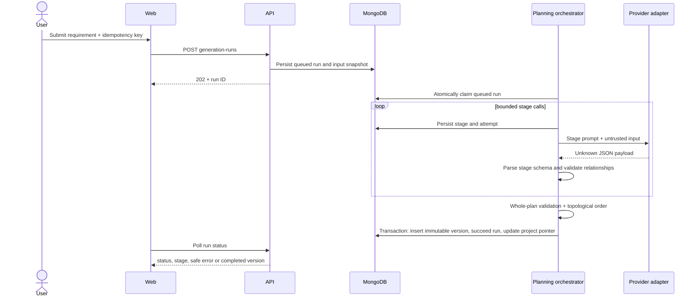
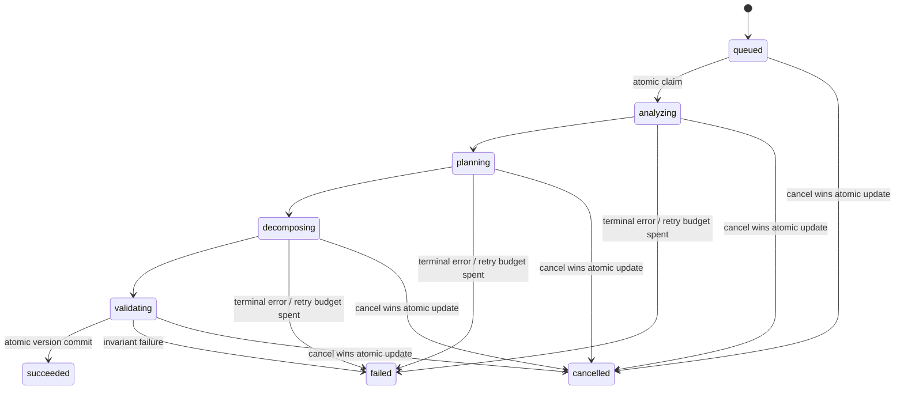

# 3. Generation Workflow and Run State Machine

## 3.1 Sequence

Provider output is always `unknown` until parsed. Deterministic validation is the final
authority for persistence eligibility. The pipeline uses three provider calls so a separate
whole-plan AI review does not consume an additional rate-limited request.

## 3.2 Ordered stages

1. **Requirement Analyst:** extract goals, requirements, acceptance criteria, constraints,
   assumptions, and open questions. Preserve uncertainty.
2. **Feature and Story Planner:** assign each requirement a coverage outcome and instruct the
   model to produce three to ten Features. Planner schema and final generation validation
   reject output above ten; the model must group related capabilities while preserving
   requirement coverage.
3. **Task Decomposer:** produce development/testing Tasks with completion criteria, priority,
   and dependency edges. Every Story must receive at least one Task.
4. **Deterministic validator:** parse the complete plan; enforce structural and technical
   invariants; recalculate dependency order; and reject invalid output, including generated
   plans with more than ten Features.
5. **Version commit:** atomically save immutable plan version, mark the run succeeded, and
   advance the project's current-version pointer.

The three AI stages are bounded model calls, not autonomous services or independent agents.
No stage can bypass persistence validation.

## 3.3 State machine

`grooming` remains a recognized legacy run status for records created by earlier builds;
new generation runs never call or enter that stage.

Terminal states are `succeeded`, `failed`, and `cancelled`. A new submission creates a new
run; never mutate a terminal run back to queued. A stale `baseVersion` fails with
`VERSION_CONFLICT` and creates no version.

## 3.4 Retry, cancellation, and restart rules

- Retry transient provider failures and schema/quality-correction failures at most twice per
  stage (three total attempts); use bounded exponential backoff with jitter.
- Do not retry authentication, unsupported-model, or non-rate-limit quota errors.
- Persist overall and per-stage attempts before/while a call runs. Error details stored for
  operators must be sanitized; public responses contain stable code/message only.
- Cancellation atomically transitions queued/active to cancelled. Check cancellation before
  and after every provider call and immediately before commit. A late response cannot commit.
- On process startup, mark old active runs interrupted and resume only queued runs. The
  current design does not checkpoint model outputs; active work restarts as a new run rather
  than pretending to resume mid-stage.
- Idempotency is scoped by project and key. Same key + same normalized request returns the
  existing run; same key + different request returns conflict.
- A run captures requirement, instructions, project context, base version, provider, model,
  prompt version, and request fingerprint at creation. Later project edits do not rewrite
  that snapshot.
