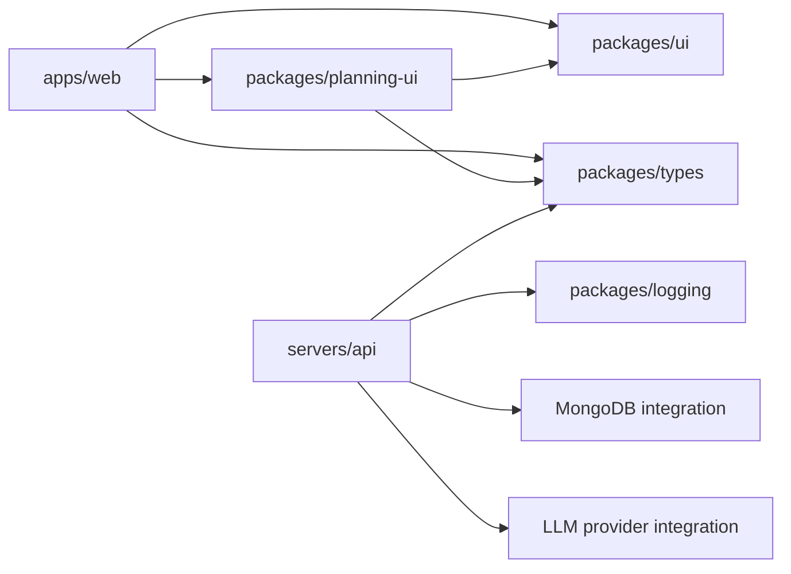

# 9. Implementation Code Map

**Scope:** this document maps the current Agentic AI planning feature to the files that
implement it. It describes the checked-out code, not a future target design.

## Workspace overview

```text
Agentic-ai/
├── apps/web/                         Next.js UI and browser-side API client
├── servers/api/                      Express API, planning use cases and integrations
├── packages/planning-ui/             Reusable planning React component library
├── packages/ui/                      Shared shadcn primitives/compositions
├── packages/types/                   Shared web/API contracts
├── packages/logging/                 Shared structured logging
├── packages/tsconfig/                Shared TypeScript compiler policy
└── architecture/                     Architecture and implementation documents
```

The package dependency graph relevant to this feature is:



`apps/web` and `servers/api` communicate over HTTP/JSON. The API does not import the web
app or the planning UI package. The browser never imports or connects to the database or
LLM provider.

## Frontend file tree and connections

```text
apps/web/
├── app/
│   ├── layout.tsx                         Root document, global CSS and app shell
│   ├── globals.css                        Tailwind theme and package source scanning
│   └── (public)/
│       ├── page.tsx                       Existing home/health entry page
│       └── agentic-ai/page.tsx             Reads API URL and mounts PlanningChat
├── config/
│   ├── env.ts                              Validated web environment access
│   └── api.ts                              NEXT_PUBLIC_API_BASE_URL -> API config
└── features/planning-chat/
    ├── index.ts                            Feature public entry point
    ├── planning-chat.tsx                   Layout and composition of UI pieces
    └── use-planning-chat.ts                 HTTP calls, polling and page state

packages/planning-ui/
├── package.json                            @workspace/planning-ui public package entry
└── src/
    ├── index.ts                             Deliberate library export surface
    └── components/
        ├── planning-chat-components.tsx     Setup, suggestion, avatar and workflow UI
        ├── plan-result.tsx                  Feature -> Story -> Task plan display
        └── saved-plans.tsx                  Project/version history and preview UI

packages/ui/src/primitives/                 Buttons, cards, labels, textarea, etc.
packages/types/src/api/planning/             Shared request/response and plan contracts
```

### Frontend ownership

- `agentic-ai/page.tsx` is a thin route: it reads validated configuration and passes the API
  base URL to the planning feature.
- `planning-chat.tsx` composes the page layout and imports reusable components through the
  public `@workspace/planning-ui` entry point. It should not deep-import package internals.
- `use-planning-chat.ts` owns browser-side state and HTTP behavior: project creation,
  existing-plan lookup, run creation and polling, loading saved versions, acceptance,
  cancellation, and version deletion.
- `packages/planning-ui/src/index.ts` is the supported component/type API for consumers.
  Components are built into `dist/`; package exports expose source types and built runtime
  JavaScript. The web app's Tailwind CSS scans the package source through `@source` in
  `apps/web/app/globals.css`.
- `packages/types` carries the shared TypeScript shapes. API runtime Zod validation remains
  owned by `servers/api/features/planning`.

### Reuse the planning UI package in another workspace app

Add the workspace dependency to the consumer's `package.json`:

```json
{
  "dependencies": {
    "@workspace/planning-ui": "workspace:*"
  }
}
```

Then import only exported names:

```tsx
import { PlanResult, SavedPlans } from "@workspace/planning-ui";
```

Build the workspace package before a consumer relies on its runtime entry:

```powershell
pnpm --filter @workspace/planning-ui build
```

The package is currently a **private pnpm workspace library**. It is reusable by apps in
this monorepo; it is not configured as a public npm package. Consumers need compatible React,
the workspace UI/types packages, and any required Tailwind source/theme setup.

## Backend file tree and connections

```text
servers/api/
├── server.ts                              Composition root and startup lifecycle
├── bootstrap/
│   ├── create-app.ts                      Express middleware and feature registration
│   ├── create-server.ts                   HTTP server lifecycle
│   └── shutdown.ts                        Graceful shutdown
├── config/                                Validated API configuration
├── middleware/
│   ├── cors.ts                            Allows configured web origin
│   ├── request-id.ts                      Request correlation ID
│   └── errors.ts                          Stable error response mapping
├── features/planning/
│   ├── index.ts                            Public feature composition/types
│   ├── routes/
│   │   └── planning.route.ts               HTTP path -> controller methods
│   ├── planning.controller.ts              HTTP input/output and response contracts
│   ├── planning.service.ts                 Project/run/version use cases and AI stages
│   ├── planning.repository.ts              Persistence contract/factory
│   ├── planning.validation.ts              Zod schemas and plan invariants
│   ├── tests/                              API and generation behavior tests
│   └── API.md                              Endpoint contract reference
├── integrations/
│   ├── llm/provider.ts                     Groq/Gemini adapter and normalized errors
│   └── mongodb/
│       ├── connection.ts                   Mongoose connection lifecycle
│       ├── planning.models.ts               Project/run/version collections and indexes
│       └── planning.repository.ts           Mongo queries and transactional writes
└── constants/, errors/, types/, validation/ Shared API runtime concerns
```

The planning feature's runtime schemas are in `planning.validation.ts`; `planning.service.ts`
uses them to validate stage output and the complete plan before persistence. The MongoDB
adapter implements the feature repository contract; service logic depends on that contract,
not directly on Mongoose models.

## File-to-file ownership map

| Starts at | Connects to | Responsibility |
| --- | --- | --- |
| `apps/web/app/(public)/agentic-ai/page.tsx` | web config + planning-chat feature | Supplies validated API URL to page UI |
| `planning-chat.tsx` | `@workspace/planning-ui`, `use-planning-chat.ts` | Renders layout and delegates state/network operations |
| `use-planning-chat.ts` | `packages/types`, `/api/...` | Browser API calls and interactive workflow state |
| `servers/api/server.ts` | config, MongoDB, LLM, repository, service, bootstrap | Constructs explicit dependencies once |
| `bootstrap/create-app.ts` | health + planning route factories, middleware | Registers HTTP features and shared middleware |
| `planning.route.ts` | `planning.controller.ts` | Declares endpoint paths and binds handlers |
| `planning.controller.ts` | `planning.service.ts`, planning validation, shared contracts | Validates HTTP boundary and shapes responses |
| `planning.service.ts` | repository contract, LLM provider contract, planning validation | Orchestrates project/run/version and generation behavior |
| `planning.repository.ts` | Mongo repository adapter contract | Separates use cases from persistence implementation |
| `integrations/mongodb/planning.repository.ts` | planning models + Mongoose connection | Reads/writes records and commits version transactions |
| `integrations/llm/provider.ts` | Groq/Gemini remote APIs | Sends model requests and normalizes provider failures |
| `packages/types/src/api/planning/` | web and API | Shares compile-time API/plan shapes across the HTTP boundary |

## Planning API routes

The current route definitions are in `servers/api/features/planning/routes/planning.route.ts`;
full request and response details are in `servers/api/features/planning/API.md`.

```text
Projects:
  POST   /api/projects
  GET    /api/projects
  GET    /api/projects/:projectId
  PATCH  /api/projects/:projectId

Generation:
  POST   /api/projects/:projectId/generation-runs
  GET    /api/generation-runs/:runId
  POST   /api/generation-runs/:runId/cancel

Saved requirements and versions:
  POST   /api/planning/versions/lookup
  GET    /api/projects/:projectId/versions
  GET    /api/projects/:projectId/versions/:version
  GET    /api/projects/:projectId/versions/compare?from=1&to=2
  POST   /api/projects/:projectId/versions
  POST   /api/projects/:projectId/versions/:version/accept
  DELETE /api/projects/:projectId/versions/:version
```

## Persisted record relationships

```text
Project
├── currentVersion ───────────────┐
├── acceptedVersion ──────────────┼──> ArchitectureVersion(projectId, version)
└── GenerationRun[]               │        ├── inputSnapshot
    ├── projectId ─────────────────┘        └── plan
    └── resultVersion ───────────────────────> ArchitectureVersion
```

An `ArchitectureVersion` stores the whole plan snapshot: requirement brief, Features,
Stories, Tasks, dependency links, input provenance and validation result. The hierarchy is
not split into mutable feature/story/task collections. Generation and user edits append
versions transactionally; acceptance points at an existing version.

