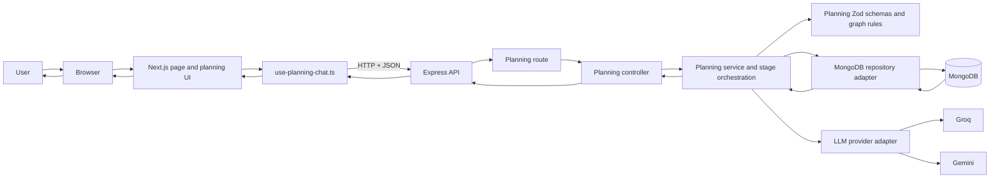
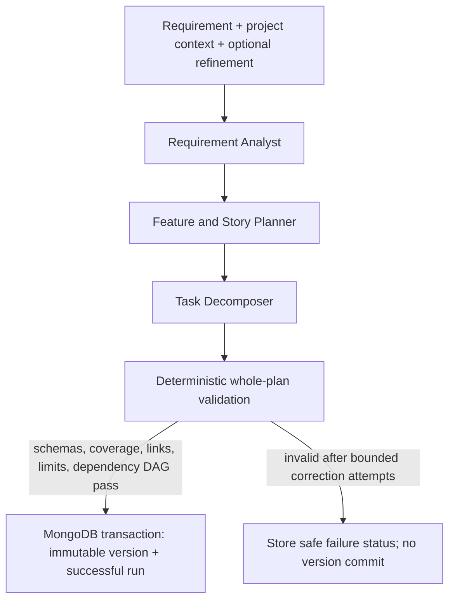
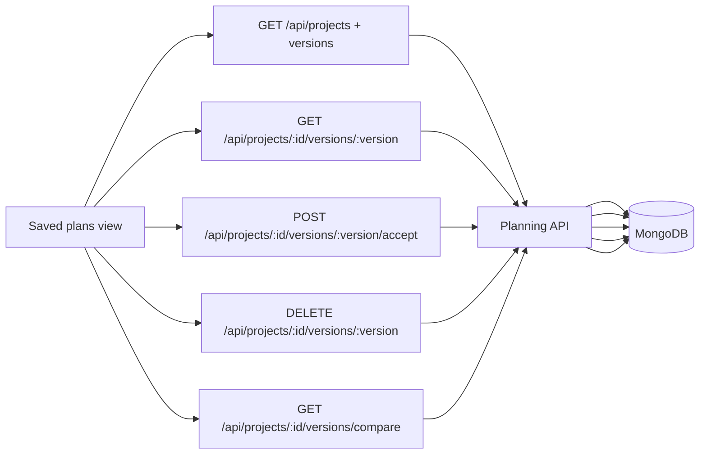

# 10. Frontend and Backend System Flow

**Scope:** actual request paths from the planning chat through the API, AI provider, and
MongoDB. This document complements the endpoint contracts in
[`servers/api/features/planning/API.md`](../servers/api/features/planning/API.md).

## Runtime connection



The API base URL is read from `NEXT_PUBLIC_API_BASE_URL` by web environment validation and
passed from the page into `PlanningChat`. Provider credentials and `MONGODB_URI` are read
only by the API process. The browser uses HTTP and never receives those secrets.

## New requirement submission

```mermaid
sequenceDiagram
  actor User
  participant UI as PlanningChat
  participant Hook as use-planning-chat.ts
  participant API as Express planning API
  participant DB as MongoDB
  participant AI as Groq/Gemini adapter

  User->>UI: Enter requirement and submit
  UI->>Hook: handleSubmit()
  Hook->>API: POST /api/planning/versions/lookup
  API-->>Hook: exact saved match or null
  alt Saved requirement match exists
    Hook->>API: GET project/version detail as needed
    API->>DB: Read saved project and immutable version
    DB-->>Hook: saved plan data (through API)
    Hook-->>UI: Render existing plan; do not create an LLM run
  else No exact match
    Hook->>API: POST /api/projects (create or reuse named project)
    API->>DB: Save/read project
    Hook->>API: POST /api/projects/:id/generation-runs + Idempotency-Key
    API->>DB: Persist queued run and requirement snapshot
    API->>API: Start in-process generation runner
    API-->>Hook: 202 Accepted with run ID
    par Background generation in API process
      API->>DB: Claim queued run
      loop Bounded stage calls
        API->>AI: Stage request (analyst, planner, decomposer)
        AI-->>API: Untrusted model JSON
        API->>API: Parse stage schema and check output
      end
      API->>API: Validate full plan and task dependency order
      API->>DB: Transactionally append version and mark run succeeded
    and Web observes run
      loop Poll until terminal run status
        Hook->>API: GET /api/generation-runs/:runId
        API->>DB: Read run status and result version
        API-->>Hook: status, stage, error or completed plan
      end
      Hook-->>UI: Render Feature -> Story -> Task hierarchy
    end
  end
```

The generation runner continues in the API after the initial `202`; status polling is how the
web UI observes progress. Saved requirement lookup happens before starting a generation run,
so an exact existing requirement/context match can be reused without consuming another model
request.

## AI stages and validation gate



All generated provider content starts as untrusted data. The validator owns the final
decision to commit a plan. It checks schemas, requirement coverage, Feature/Story/Task
references, feature limits, dependency graph, and deterministic task order. Invalid output
does not become a saved version.

## Review and version actions



Version data is immutable after creation. Accept changes the accepted-version pointer;
delete removes a requested version and compacts remaining version numbers in a MongoDB
transaction. The UI displays the saved brief/version labels alongside the selected plan.

## Errors and boundaries

1. Browser requests use the configured API base URL and JSON contracts.
2. Request ID and CORS middleware run before feature routes; the error middleware formats
   unexpected and known failures into the stable API error envelope.
3. HTTP validation failures return field paths/codes without echoing requirement content.
4. Provider failures are normalized by the LLM adapter; raw credentials, prompts, model
   payloads, and stack traces are not returned to the browser.
5. Persistence failures do not produce a successful version. Version commits require a
   MongoDB replica set or sharded cluster because they use transactions.
6. V1 has no authentication and is intended for local/demo single-user use only.

## Implementation references

| Concern | Source of truth |
| --- | --- |
| Web page and API URL | `apps/web/app/(public)/agentic-ai/page.tsx`, `apps/web/config/` |
| Browser state and request flow | `apps/web/features/planning-chat/use-planning-chat.ts` |
| Chat and saved-plan composition | `apps/web/features/planning-chat/planning-chat.tsx` |
| Reusable React library exports | `packages/planning-ui/src/index.ts` |
| Shared HTTP/plan TypeScript contracts | `packages/types/src/api/planning/` |
| API registration and runtime composition | `servers/api/server.ts`, `servers/api/bootstrap/create-app.ts` |
| Planning HTTP endpoints | `servers/api/features/planning/routes/planning.route.ts` |
| Request/response translation | `servers/api/features/planning/planning.controller.ts` |
| Use cases and AI stage orchestration | `servers/api/features/planning/planning.service.ts` |
| Planning runtime schemas | `servers/api/features/planning/planning.validation.ts` |
| MongoDB collections and adapter | `servers/api/integrations/mongodb/` |
| Provider boundary and adapters | `servers/api/integrations/llm/provider.ts` |

