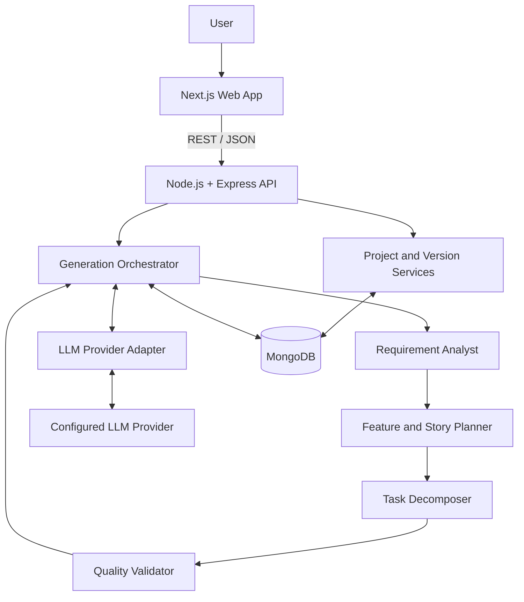
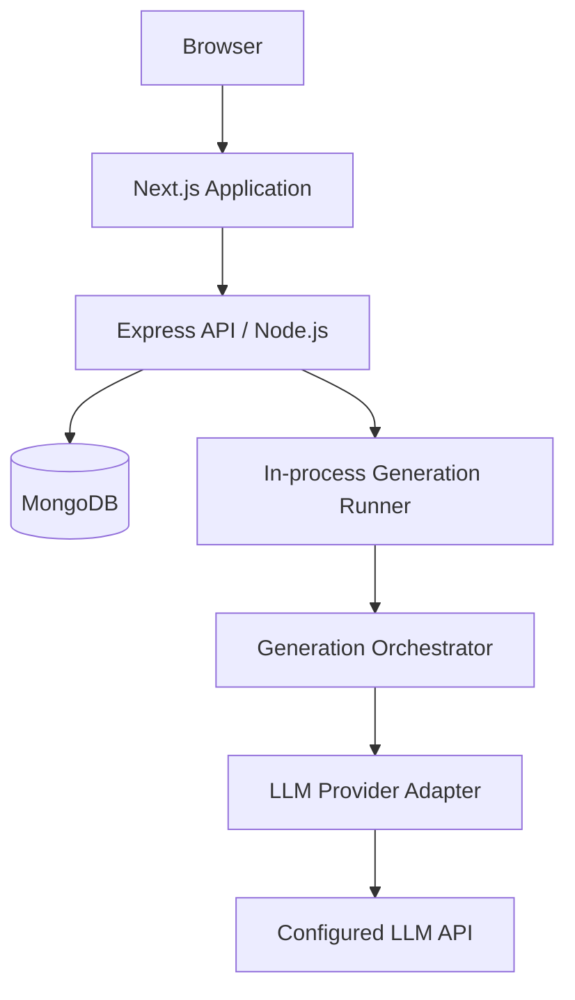

> **Historical document:** This consolidated v1.1 document is retained for context only.
> The current canonical architecture is split under [`README.md`](README.md). New work must
> follow that set where decisions differ.

# Agentic AI — Software Requirements-to-Plan Architecture

**Document Version:** 1.1 (v1.0 baseline with proposed amendments)  
**Status:** v1.0 finalized; v1.1 amendments proposed  
**Date:** 17 October 2026  
**Scope:** Convert software requirements into a validated, editable, versioned plan of Features → User Stories → Tasks.

---

## 1. Executive Summary

The system accepts a written software requirement and optional project context. It produces a structured planning artifact containing a requirement brief, Features, User Stories, development and testing Tasks, task dependencies, assumptions, open questions, and validation findings.

The system is an **AI-assisted planning tool**, not an autonomous software factory. It does not write application code, modify repositories, execute tasks, create pull requests, or deploy software. Generated plans remain proposals until a user reviews and accepts them.

Version 1 uses a central generation orchestrator with specialized, sequential AI stages. MongoDB stores projects, generation runs, and immutable plan versions. Distributed agents, a separate queue, and additional infrastructure are deferred until justified by actual operational needs.

## 2. Product Objectives and Scope

### 2.1 Objectives

- Convert natural-language requirements into actionable plans.
- Preserve traceability from requirements to Features, Stories, and Tasks.
- Generate explicit acceptance and completion criteria.
- Generate task dependencies and a valid implementation order.
- Surface assumptions and unanswered questions without blocking generation.
- Support review, editing, acceptance, comparison, and regeneration.
- Preserve previous versions and generation outcomes.
- Validate output before saving a successful version.

### 2.2 In Scope for V1

- Text-based requirement input and optional project context.
- Multiple projects and generation history for a single-user demo.
- Sequential AI stages coordinated by one orchestrator.
- Feature, User Story, and Task generation.
- Task types: `development` and `testing`.
- Dependency and ordering validation.
- Version history, editing, comparison, acceptance, and regeneration.
- Generation status, bounded retries, and safe error reporting.

### 2.3 Out of Scope for V1

- Application source-code generation or modification.
- Autonomous task execution, repository access, branches, pull requests, CI, or deployment.
- A distributed autonomous-agent swarm.
- Multi-user authentication, authorization, and collaboration.
- A separate message broker or worker deployment.
- Treating AI output as approved without human review.

**Deployment restriction:** The single-user demo must not be exposed as a public multi-user application until authentication, project ownership enforcement, rate limiting, and data-retention controls are implemented.

## 3. Reference Principles

The public [Squid: The Software Factory repository](https://github.com/iusztinpaul/squid) describes a planning workflow in which a Product Architect grooms a task plan and a human approval gate precedes implementation.

This architecture adopts the relevant principles: structured planning, specialized responsibilities, explicit acceptance criteria, and human approval. It deliberately excludes implementation, code review, CI, and deployment stages.

This is an independent architecture inspired by publicly documented behavior. It does not claim to reproduce Squid's private prompts, models, orchestration implementation, or internal data model.

The supplied [Architecture Handbook](https://adeelchainz.github.io/first-step/architecture-handbook) could not be verified during preparation, so no specific claims are attributed to it.

## 4. Architecture Principles

1. **Human-owned decisions:** AI output is a proposal; the user controls acceptance.
2. **Central orchestration:** One state machine controls stage order, retries, cancellation, validation, and persistence.
3. **Specialized stages:** Each AI stage has a bounded responsibility and explicit input/output contract.
4. **Validation before persistence:** Invalid or partial output cannot become a successful plan version.
5. **Immutable history:** Editing and successful regeneration create new versions.
6. **Traceability:** Features and Stories reference requirements; Tasks reference Stories.
7. **Provider isolation:** Vendor SDKs and credentials remain behind a server-side adapter.
8. **Operational simplicity:** V1 runs in one API process.
9. **Explicit uncertainty:** Assumptions remain assumptions; unanswered questions do not become confirmed facts.

## 5. System Architecture



### 5.1 Component Responsibilities

| Component | Responsibility |
|---|---|
| Next.js web app | Requirement input, project list, run progress, plan display, editing, version history, comparison |
| Express API | HTTP contracts, request validation, error mapping, application-service composition |
| Generation orchestrator | Run state machine, stage sequence, retry limits, timeouts, cancellation, validation gate, commit coordination |
| Requirement Analyst | Structured brief, requirement IDs, goals, constraints, assumptions, open questions |
| Feature and Story Planner | Features and Stories linked to requirement IDs |
| Task Decomposer | Development/testing Tasks, completion criteria, dependencies, task order |
| Quality Validator | Schema checks, traceability, relationship checks, dependency graph validation |
| LLM provider adapter | Provider-specific calls, response normalization, timeouts, usage metadata |
| MongoDB repositories | Projects, runs, immutable versions, indexes, concurrency checks |

The AI stages may use the same model with different prompts and output schemas. They are not independent services or autonomous agents. Separate services are not required for V1.

## 6. Generation Workflow

1. The user creates or selects a project and submits a requirement, with optional context and instructions.
2. The API validates the request and persists a generation run with an immutable input snapshot.
3. The API returns `202 Accepted` with a `runId`.
4. The orchestrator executes these stages in order:
   - Requirement Analyst
   - Feature and Story Planner
   - Task Decomposer
   - Quality Validator
5. Every model response is parsed against its runtime schema.
6. If the requirement is unclear, the system still produces a best-effort plan and records assumptions and open questions.
7. Only a candidate that passes hard validation and the version concurrency check may be saved as a successful version.
8. The user can review, edit, accept, compare, or regenerate the plan. Generated tasks are never executed.

### 6.1 Run State Machine

Normal path:

`queued → analyzing → planning → decomposing → validating → succeeded`

Any active state may transition to `failed` or `cancelled`.

Terminal states are `succeeded`, `failed`, and `cancelled`. A stale version conflict ends the run without creating a new plan version.

The run stores its input snapshot, current stage, timestamps, provider/model identifiers, prompt version, attempt count, result reference, and safe error details.

## 7. Domain Model

Use three logical MongoDB collections:

- `projects`
- `generation_runs`
- `architecture_versions`

Store timestamps in UTC and include explicit schema versions.

### 7.1 Requirement Brief

```ts
type RequirementBrief = {
  goals: string[];
  requirements: Array<{
    id: string;
    text: string;
    acceptanceCriteria: string[];
  }>;
  constraints: string[];
  assumptions: string[];
  openQuestions: string[];
};
```

Requirement IDs provide traceability within a plan version. Open questions do not block generation in V1.

### 7.2 Feature

```ts
type Feature = {
  id: string;
  title: string;
  description: string;
  priority: "low" | "medium" | "high" | "critical";
  requirementIds: string[];
};
```

Every Feature must reference at least one requirement.

### 7.3 User Story

```ts
type UserStory = {
  id: string;
  featureIds: string[];
  requirementIds: string[];
  title: string;
  description: string;
  acceptanceCriteria: string[];
  priority: "low" | "medium" | "high" | "critical";
};
```

Every Story must reference at least one existing Feature and one requirement.

### 7.4 Task

```ts
type Task = {
  id: string;
  storyId: string;
  title: string;
  description: string;
  taskType: "development" | "testing";
  completionCriteria: string[];
  priority: "low" | "medium" | "high" | "critical";
  dependsOn: string[];
  order: number;
};
```

- `storyId` identifies the parent Story.
- `taskType` classifies the work as development or testing.
- `completionCriteria` defines when the task is considered complete.
- `dependsOn` contains prerequisite Task IDs.
- `order` represents a deterministic valid topological ordering.

Tasks should be small enough to review independently. Task order does not imply that tasks are automatically executed.

### 7.5 Project

```ts
type Project = {
  _id: ObjectId;
  name: string;
  context: string;
  currentVersion: number | null;
  acceptedVersion: number | null;
  createdAt: Date;
  updatedAt: Date;
};
```

`currentVersion` is the latest successful version. `acceptedVersion` is the version explicitly accepted by the user.

### 7.6 Generation Run

```ts
type GenerationRun = {
  _id: ObjectId;
  projectId: ObjectId;
  status:
    | "queued"
    | "analyzing"
    | "planning"
    | "decomposing"
    | "validating"
    | "succeeded"
    | "failed"
    | "cancelled";
  stage: string | null;
  input: {
    requirement: string;
    context: string;
    instructions?: string;
  };
  baseVersion: number | null;
  promptVersion: string;
  provider: { name: string; model: string };
  attempts: number;
  resultVersion: number | null;
  error: {
    code: string;
    message: string;
    retryable: boolean;
  } | null;
  createdAt: Date;
  startedAt: Date | null;
  finishedAt: Date | null;
};
```

Provider credentials must never be stored in run records.

### 7.7 Architecture Version

```ts
type ArchitectureVersion = {
  _id: ObjectId;
  projectId: ObjectId;
  version: number;
  basedOnVersion: number | null;
  source: "generation" | "user-edit";
  schemaVersion: 1;
  runId: ObjectId | null;
  inputSnapshot: {
    requirement: string;
    context: string;
    instructions?: string;
  } | null;
  plan: {
    brief: RequirementBrief;
    features: Feature[];
    stories: UserStory[];
    tasks: Task[];
  };
  validation: {
    passed: true;
    checks: string[];
    warnings: string[];
  };
  createdAt: Date;
};
```

IDs must be unique within each entity type in a version. References must resolve within that version. Consumers must not assume entity IDs remain globally stable across regenerated versions.

## 8. Persistence and Versioning

### 8.1 Indexes

- Unique `{ projectId: 1, version: 1 }` on `architecture_versions`.
- `{ projectId: 1, createdAt: -1 }` on `generation_runs`.
- `{ projectId: 1, version: -1 }` on `architecture_versions`.
- Additional run-recovery indexes where required by recovery queries.

### 8.2 Commit Rules

- A successful commit inserts the immutable version, marks the run successful, and updates `projects.currentVersion` atomically.
- MongoDB must support transactions for this multi-document atomic commit contract. Production-like deployment requires a replica set or sharded cluster.
- If transaction support is unavailable, the application must not claim transactional guarantees; the deployment must either fail readiness checks or use a separately documented consistency strategy.
- Before committing, compare the run's `baseVersion` with the current project version.
- If the versions differ, fail with `VERSION_CONFLICT` and do not create a version.
- User edits must include `baseVersion`; stale edits return `409 VERSION_CONFLICT`.
- Version records are append-only. Previous versions are never overwritten.
- Failed and cancelled runs remain in history but do not create successful versions.

### 8.3 Edit, Regeneration, and Acceptance

- Regeneration creates a new run with an input snapshot and base version.
- A successful regeneration creates a new immutable version.
- If the project's current version changes during generation, the stale result is not committed automatically.
- Editing creates a new version with `source: "user-edit"` and `basedOnVersion` set to the edited version.
- Comparison is read-only.
- Acceptance updates `acceptedVersion` only. It does not change plan contents or execute tasks.

## 9. API Contracts

All endpoints use JSON under `/api`. Validate requests and responses with Zod and return a consistent error envelope.

### 9.1 Projects

- `POST /api/projects` — create a project.
- `GET /api/projects` — list projects for the single-user demo.
- `GET /api/projects/{projectId}` — read project metadata.
- `PATCH /api/projects/{projectId}` — update project name/context.

### 9.2 Generation

`POST /api/projects/{projectId}/generation-runs`

Request:

```json
{
  "requirement": "Users can plan a software project from a written brief.",
  "context": "Next.js web app, Express API, MongoDB.",
  "instructions": "Prefer a small first release."
}
```

Response: `202 Accepted`

```json
{
  "runId": "...",
  "status": "queued",
  "createdAt": "..."
}
```

Additional endpoints:

- `GET /api/generation-runs/{runId}` — read run status, stage, timestamps, safe errors, and result version.
- `POST /api/generation-runs/{runId}/cancel` — request cancellation; return `202` when pending or `409` if already terminal.

### 9.3 Versions

- `GET /api/projects/{projectId}/versions` — list version summaries, newest first.
- `GET /api/projects/{projectId}/versions/{version}` — read a complete immutable plan.
- `GET /api/projects/{projectId}/versions/compare?from=2&to=3` — compare two versions.
- `POST /api/projects/{projectId}/versions` — create an edited version from `{ "baseVersion": 3, "plan": { ... } }`.
- `POST /api/projects/{projectId}/versions/{version}/accept` — accept an existing version.

The edit endpoint returns `201` on success or `409 VERSION_CONFLICT` for a stale base version.

### 9.4 Error Envelope

```json
{
  "error": {
    "code": "VALIDATION_FAILED",
    "message": "The generated plan needs correction before it can be saved.",
    "requestId": "...",
    "details": []
  }
}
```

Use stable codes such as `INVALID_REQUEST`, `PROJECT_NOT_FOUND`, `RUN_NOT_FOUND`, `VALIDATION_FAILED`, `PROVIDER_UNAVAILABLE`, `RUN_INTERRUPTED`, `VERSION_CONFLICT`, and `CANCELLED`.

Never return provider secrets, raw prompts, stack traces, or unfiltered provider responses to the browser.

### 9.5 V1 Security Boundary

V1 is a single-user demo without authentication. It must not be described as secure multi-user access control. A project ID is not an authorization mechanism.

Before public or multi-user deployment, add authentication, project ownership checks on every project/run/version endpoint, rate limiting, and retention/deletion policies.

## 10. Validation and Quality Gates

Validation is deterministic in V1 and does not call a second LLM. Hard failures prevent persistence; warnings are shown to the user.

### 10.1 Stage-Level Validation

- Parse each stage response against its runtime Zod schema.
- Enforce input/output size limits and collection limits.
- Validate required fields and enum values.
- Reject malformed output rather than coercing it into apparent success.
- Retry invalid stage output only within the bounded retry budget.

### 10.2 Whole-Plan Checks

1. The complete plan matches the declared schema.
2. IDs are unique within each entity type.
3. Every Feature traces to at least one requirement.
4. Every Story references an existing Feature and requirement.
5. Every Task references an existing Story.
6. Every dependency references an existing Task.
7. No self-dependencies or duplicate dependency edges exist.
8. The dependency graph is acyclic and a deterministic topological order can be produced.
9. No orphan records or invalid priority/task-type values exist.
10. Submitted requirements are addressed or explicitly identified as unresolved/out of scope.
11. Assumptions and open questions are not presented as confirmed facts.
12. The plan respects configured size and complexity limits.

Warnings may identify vague acceptance criteria, possible duplication, unusually broad tasks, or unresolved assumptions.

Passing validation confirms structural consistency and traceability, not business correctness. Human review remains required.

## 11. LLM Provider Boundary

Use an application-owned provider interface independent of any vendor SDK:

```ts
type LlmRequest<T> = Readonly<{
  stage: string;
  systemInstructions: string;
  input: unknown;
  outputSchema: z.ZodType<T>;
  timeoutMs: number;
}>;

type LlmProvider = Readonly<{
  generate: <T>(request: LlmRequest<T>) => Promise<T>;
}>;
```

The concrete adapter owns provider SDK calls, structured-output handling, timeouts, error normalization, and available usage metadata.

- Select the provider/model through server configuration.
- Version prompt assets and record `promptVersion`, provider, and model per run.
- Changes to output structure require a schema-version change and compatibility review.
- Store credentials in validated server-side environment variables, never in client input or `NEXT_PUBLIC_*` variables.
- Treat requirements and model output as untrusted data that cannot override system instructions or security boundaries.

The provider is intentionally undecided in this architecture version.

## 12. Failure Handling and Recovery

| Failure | Required behavior |
|---|---|
| Invalid request or unknown project | Return `400` / `404`; do not create a run. |
| Temporary provider/network failure | Retry the current stage at most twice, using exponential backoff and jitter; honor `Retry-After` when available. |
| Provider authentication, quota, or unsupported-model error | Fail with a safe actionable code; do not treat it as transient. |
| Timeout or malformed output | Retry within the stage budget, then fail with safe stage/findings details. |
| Hard validation failure | Do not create a version; preserve the failed run and findings. |
| Database unavailable before run creation | Return `503`; do not start untracked work. |
| Failure during final commit | Use the transaction to prevent partial version/current-pointer updates. |
| Process restart | Resume queued runs. Mark abandoned active runs `RUN_INTERRUPTED` unless safe stage checkpointing exists. |
| Concurrent edit/generation | Reject stale work with `409 VERSION_CONFLICT`; create no version. |
| Cancellation | Persist cancellation and check between provider calls. Discard late results if cancellation has already won the state transition. |

V1 uses an in-process runner. It must prevent duplicate processing of the same run within the process. A separate durable queue/worker is deferred until throughput, recovery, or isolation requirements justify it.

## 13. Security, Privacy, and Operations

- Keep LLM and database credentials on the server.
- Treat model output as untrusted: parse it, enforce limits, render it safely, and never execute it.
- Do not log raw requirements, prompts, credentials, or full provider responses by default.
- Correlate logs with `requestId`, `projectId`, and `runId`; redact sensitive error metadata.
- Enforce request size limits, timeouts, retry caps, and provider usage limits.
- Define retention, export, and deletion rules before supporting multiple users or sensitive data.
- Monitor run outcomes, stage durations, provider latency/error classes, retries, available usage/cost metadata, validation failures, and database commit failures.

## 14. Deployment Architecture



V1 uses Next.js, Node.js, TypeScript, Express, Zod, and MongoDB. The API and orchestrator run in one server process. MongoDB must support transactions for the documented atomic commit behavior.

A separate worker, queue, cache, vector database, or multi-agent runtime is not required by the current scope. New infrastructure requires an explicit decision based on a measurable need.

## 15. Repository Ownership Map

This is an intended implementation map, not a claim that these features already exist.

```text
apps/web/features/architecture-planning/       Input, run status, plan review, editing, history
servers/api/features/projects/                 Project endpoints and application operations
servers/api/features/generation/               Run endpoints, orchestrator, stages, validation
servers/api/features/versions/                  Version reads, edits, acceptance, comparisons
servers/api/integrations/llm/                  Provider interface and concrete adapter
```

Keep feature-owned code close to its responsibility. Promote contracts into a shared workspace package only when both frontend and backend need the same contracts. Keep MongoDB persistence behind server-owned repositories. Do not create empty folders for hypothetical future agents.

## 16. Key Decisions

| Decision | V1 choice | Rationale |
|---|---|---|
| Orchestration | One in-process state machine | Simple, explicit control |
| AI stages | Sequential specialized stages | Clear contracts and traceable failures |
| LLM provider | Provider-neutral adapter | Vendor independence |
| Quality gate | Schema and deterministic graph/relationship checks | Predictable persistence gate |
| Unclear requirements | Best-effort output with assumptions/questions | No clarification-blocking workflow |
| Version history | Immutable versions and current/accepted pointers | Comparison and safe edits |
| Consistency | MongoDB transaction plus base-version checks | Avoid partial commits and stale overwrites |
| Human control | Review/edit/accept/regenerate; no execution | Keeps scope limited to planning |
| Authentication | Out of scope for single-user demo | Must be added before multi-user exposure |

## 17. Acceptance Criteria

The implementation aligns with this architecture when:

- Users can create/select projects and submit requirements with optional context.
- Runs are persisted before processing and the UI shows queued, active, succeeded, failed, and cancelled states.
- Plans contain requirement briefs, Features, Stories, Tasks, priorities, acceptance/completion criteria, task types, and dependencies.
- Ambiguous requirements produce best-effort output with explicit assumptions/open questions.
- Traceability and dependency rules are enforced.
- Invalid or incomplete output never becomes a successful saved version.
- Users can review history, compare versions, edit from a base version, accept a version, and regenerate.
- Every edit or successful regeneration creates a new immutable version.
- Stale concurrent writes are rejected without partial commits.
- Provider failures, timeouts, malformed output, cancellation, restarts, and persistence failures follow documented behavior.
- Secrets and raw provider errors remain server-side.
- Tests cover schemas, graph validation, orchestration transitions, provider failures, version consistency, API contracts, and the user review flow.

## 18. References

- [Squid: The Software Factory — public repository](https://github.com/iusztinpaul/squid). Publicly documented planning, Product Architect task grooming, and human approval concepts.
- [Squid planning workflow summary](https://skillsmp.com/creators/iusztinpaul/squid/skills-squid-plan). Secondary summary of the planning workflow.
- [Architecture Handbook](https://adeelchainz.github.io/first-step/architecture-handbook). Supplied reference, unavailable for verification during preparation.

---

**Architecture status:** Finalized baseline for v1 planning. This document defines the intended design; it does not imply that code or infrastructure has already been implemented.

---

## Proposed v1.1 Amendment Addendum

**Precedence:** The v1.0 baseline above remains the finalized baseline. The following proposed amendments supersede conflicting v1.0 decisions only when v1.1 is adopted; until then they are clearly identified as proposed.

# Agentic AI — Architecture v1.1 Amendments

**Base document:** Agentic AI — Software Requirements-to-Plan Architecture v1.0  
**Revision date:** 17 October 2026  
**Revision status:** Proposed architecture update  
**Scope:** Preserve the existing architecture and refine planning workflow, provider configuration, validation, reliability, and implementation contracts.

## 1. AI Provider Decision

V1 will support two LLM providers:

- **Groq API**
- **Google Gemini API**

The application will use a provider-neutral adapter so orchestration and domain logic do not depend directly on either provider's SDK.

### Provider requirements

- The active provider and model must be configurable on the backend.
- Provider credentials must be stored in server-side environment variables.
- API keys must never be sent to the browser or exposed through `NEXT_PUBLIC_*` variables.
- Each generation run must record its provider name, model identifier, and prompt version.
- Provider-specific response formats, structured-output capabilities, timeouts, and error codes must be normalized by the adapter.
- Provider and model selection must be validated against the configured supported options.
- Retry only transient errors and malformed responses within the configured retry limit. Authentication errors, quota exhaustion, and unsupported-model errors must not be retried indefinitely.

Example configuration names:

- `LLM_PROVIDER=groq` or `LLM_PROVIDER=gemini`
- `GROQ_API_KEY`
- `GEMINI_API_KEY`
- `LLM_MODEL`
- `LLM_TIMEOUT_MS`

These are proposed configuration names, not a claim that the variables already exist in the repository. Exact model identifiers will be selected and tested during implementation.

## 2. Updated Generation Workflow

The generation pipeline will be:

1. Requirement Analyst
2. Feature and Story Planner
3. Task Decomposer
4. Plan Groomer
5. Deterministic Quality Validator
6. Version Commit

### Plan Groomer

The Plan Groomer is a specialized AI stage that reviews the candidate plan before deterministic validation.

It should identify:

- Missing or weakly covered requirements.
- Duplicate or substantially overlapping Features, Stories, or Tasks.
- Vague acceptance and completion criteria.
- Tasks that are too broad to review independently.
- Missing development or testing work where supported by the requirements.
- Inconsistent dependencies or unclear implementation sequencing.

The groomer may propose corrections to the candidate plan, but must not invent unsupported business requirements. Any unresolved uncertainty must remain visible as an assumption, open question, or coverage issue.

The groomer is not an autonomous agent or separate service. It runs as a bounded stage controlled by the existing generation orchestrator.

The deterministic validator remains the final authority for schema correctness, traceability, relationships, dependency cycles, and persistence eligibility.

## 3. Requirement Coverage Contract

Each requirement must have an explicit coverage outcome in the generated plan.

Add a coverage field with these values:

- `addressed`
- `open`
- `out_of_scope`

An open or out-of-scope requirement must include a concise explanation. A requirement marked as addressed must trace to the appropriate planning entities.

Coverage status does not prove business correctness. It provides an auditable indication of how the plan handles the submitted requirement.

The final plan validator must reject invalid coverage values, broken references, and unsupported claims of complete coverage.

## 4. Domain Contract Amendments

### User Stories

Each Story must belong to exactly one Feature in V1.

Use a singular `featureId` instead of `featureIds`. Stories may still reference multiple requirement IDs through `requirementIds`.

Every Story must reference an existing Feature and at least one valid requirement.

### Tasks

Use the following task types:

- `technical_development`
- `testing`

Each Task must reference one existing Story and include completion criteria, priority, dependencies, and an ordering value.

Dependencies are the source of truth for task sequencing. The validator must detect dependency cycles and calculate a deterministic topological order. The AI-generated `order` value must not be trusted without recalculation.

### Stage attempt tracking

Track attempts per stage as well as the overall run attempt count. This enables diagnosis of repeated failures and makes retry behavior auditable.

## 5. Validation Amendments

Apply the same whole-plan validator to:

- AI-generated candidate plans.
- Plans changed by the Plan Groomer.
- User-edited plans before a new version is committed.

Validation must check:

1. Runtime schema compliance and valid enum values.
2. Unique entity IDs within each plan version.
3. Requirement coverage and valid requirement references.
4. Exactly one valid parent Feature per Story.
5. A valid parent Story for every Task.
6. Existing dependency targets, without self-dependencies or duplicate edges.
7. An acyclic dependency graph.
8. Deterministic topological task ordering.
9. No unintended orphan entities.
10. Explicit handling of unresolved or out-of-scope requirements.
11. Configured size and complexity limits.

Hard validation failures must prevent a successful version commit. Warnings may be shown to the user without failing the plan, provided all hard requirements pass.

## 6. Run Reliability and Idempotency

Generation runs must be persisted before processing begins.

The generation endpoint should support an idempotency mechanism so that a repeated submission with the same idempotency key does not create duplicate runs for the same request.

The single-process runner must:

- Claim queued runs through an atomic state transition.
- Prevent the same run from being processed concurrently.
- Persist state changes and stage progress.
- Record stage-specific attempts and safe error details.
- Resume queued runs after a process restart.
- Mark abandoned active runs as interrupted unless safe checkpoint recovery is implemented.
- Recheck run status before committing results.
- Discard late provider responses if cancellation has already won the state transition.

V1 remains a single API process with an in-process runner. A distributed queue or separate worker is deferred until a measured need justifies it.

## 7. Persistence and Concurrency

A successful generation commit must atomically:

1. Insert the new immutable architecture version.
2. Mark the generation run as succeeded.
3. Update the project's current-version pointer.

The deployment must support MongoDB transactions for this contract, which requires a replica set or sharded cluster. Readiness checks must detect an unsupported deployment configuration rather than implying that atomic multi-document commits are available.

Before commit, the run's `baseVersion` must match the project's current version. A stale run must fail with `VERSION_CONFLICT` without creating a new version.

User edits must also pass the complete validator and use a base-version check.

## 8. Updated Key Decisions

| Decision | V1 choice |
|---|---|
| LLM providers | Groq and Gemini |
| Provider integration | Provider-neutral backend adapter |
| Planning stages | Requirement Analyst, Feature and Story Planner, Task Decomposer, Plan Groomer |
| Final quality gate | Deterministic whole-plan validator |
| Requirement coverage | Explicit addressed, open, or out-of-scope status |
| Story ownership | Exactly one parent Feature |
| Task types | `technical_development` and `testing` |
| Task sequencing | Dependency graph plus deterministic topological sorting |
| Retry behavior | Bounded retries with stage-level attempt tracking |
| Duplicate submission handling | Idempotency mechanism |
| Run execution | One API process with an in-process runner |
| Versioning | Immutable versions and base-version concurrency checks |
| Human control | Review, edit, accept, compare, and regenerate; no task execution |

## 9. Updated Acceptance Criteria

The implementation is aligned with this revision when:

- Both Groq and Gemini can be configured through the backend adapter.
- Provider credentials remain server-side.
- Each run records provider, model, prompt version, and stage attempts.
- The Plan Groomer runs before deterministic final validation.
- Requirement coverage is explicitly represented and validated.
- Each Story belongs to exactly one Feature.
- Task types use `technical_development` or `testing`.
- Dependency cycles are rejected and valid task order is calculated deterministically.
- Generated and user-edited plans pass the same whole-plan validation rules.
- Duplicate submissions do not unintentionally create duplicate runs.
- Cancellation, retries, restarts, and concurrent version updates follow the defined rules.
- Failed or cancelled runs do not create successful plan versions.
- Existing review, edit, acceptance, comparison, and regeneration workflows continue to preserve immutable version history.

**Architecture boundary:** This revision changes the intended architecture only. It does not mean the providers, stages, database changes, or API contracts have already been implemented or tested.

