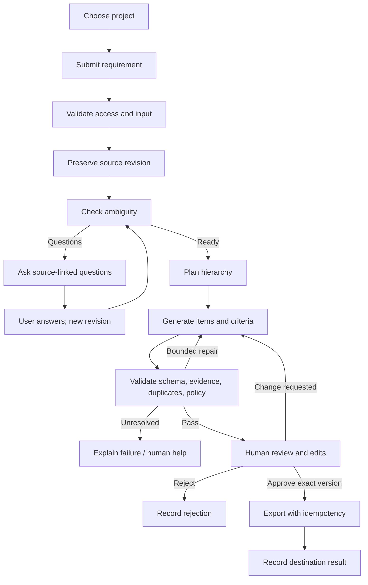

# Scope and Feature Catalogue

**Status:** Recommended MVP proposal; priorities need product-owner approval.

## MVP features

| ID | Feature | User value | Proposed MVP behavior | Priority |
|---|---|---|---|---|
| F-01 | Workspace/project context | Organize work and access. | Create/select project; attach every record to its scope. | Must |
| F-02 | Requirement intake | Capture request. | Submit text, title, project, optional context; validate access and size. | Must |
| F-03 | Source normalization | Stable generation input. | Preserve original; normalize metadata; assign source-block IDs. | Must |
| F-04 | Ambiguity clarification | Find missing decisions early. | Ask focused questions tied to source; answers create new revision. | Must |
| F-05 | Hierarchy drafting | Reduce repetitive decomposition. | Draft initiative/feature/story/task levels only where justified. | Must |
| F-06 | Acceptance criteria | Make stories testable. | Produce observable criteria; flag unresolved business decisions. | Must |
| F-07 | Source traceability | Verify generated content. | Link claims/items to source spans; mark inference/assumption. | Must |
| F-08 | Quality gate | Block malformed output. | Schema/policy validation, duplicate findings, trace checks, bounded repair. | Must |
| F-09 | Review workbench | Keep human in control. | Inspect tree/source/evidence; edit, accept, reject, request changes. | Must |
| F-10 | Version history | Preserve changes. | Immutable source/draft revisions; edits form new versions. | Must |
| F-11 | Approval gate | Prevent unreviewed publishing. | Approve exact version; any edit invalidates approval. | Must |
| F-12 | Export | Transfer approved work. | Launch with one destination selected in discovery; record response. | Must for launch |
| F-13 | Audit timeline | Accountability and investigation. | Record actor/action/target/time/version/outcome; avoid secrets/raw prompts. | Must |
| F-14 | Usage/cost controls | Prevent runaway work. | Bound calls, time, output size, retries, and quota. | Must |

## Post-MVP candidates

Office/PDF intake; multiple trackers; project templates; historical retrieval/RAG; team writing rules; dependency mapping; estimation suggestions; analytics; notifications; bulk generation; localization. Each requires an owner, acceptance criteria, privacy review, and evaluation.

## Explicit MVP exclusions

Code generation; autonomous publication; sprint planning; staffing; time tracking; billing; fine-tuning on customer data; unrestricted shell/browser tools; and estimates presented as commitments.

## End-to-end user flow

## Acceptance scenario

A product manager submits “add multi-factor login.” ARBG asks which factors, recovery behavior, and user groups are in scope if these block a useful draft. It links generated content to the original request and answers, labels unsupported implementation detail as an assumption, allows edits, and exports only the approved version. Editing after approval requires reapproval. A timed-out export is reconciled before retry to avoid duplicates.
