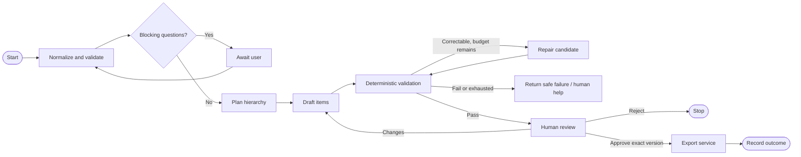

# Agent and Workflow Design

## Design stance

An “agent” is a bounded typed step whose output is a proposal. Application code owns workflow state, authorization, validation, retries, and side effects. No model receives unrestricted network, shell, database, or export tools. A single model call may cover multiple responsibilities if evaluation supports it; seven independent agents are not a requirement.

## Logical steps

| Step | Input → output | Capability | Completion condition |
|---|---|---|---|
| Intake normalizer | Source → normalized blocks/metadata | No external tools | Source preserved; invalid payload rejected. |
| Clarifier | Source + policy → questions or ready flag | No writes/export | Questions are blocking, focused, source-linked, capped. |
| Planner | Source/answers → hierarchy outline/open questions | No external tools | Typed, source-linked outline. |
| Drafter | Outline → item/criterion candidates | No external tools | Schema-valid candidate; unsupported details labeled. |
| Critic | Candidate + source + deterministic findings → issue list | No tools; cannot approve | Findings are advisory; deterministic gates decide readiness. |
| Repair | Candidate + allowlisted findings → revised candidate | No tools | Only bounded repairs, followed by complete validation. |
| Human reviewer | Candidate → edit/accept/reject/revision request | Explicit UI | Authorized human; approval tied to immutable version. |
| Exporter | Approved version → destination result | Narrow destination API | Approval rechecked; idempotency/reconciliation recorded. |

## State contract

Serializable workflow state should include workflow/workspace/project IDs, source revision, schema/config versions, current step, attempts, deadline, cost/token budget, candidate version, findings, review status, and export status. Avoid opaque framework objects as durable state. Sensitive source is excluded from diagnostic logs.

## Prompt/output controls

- Keep trusted policy separate from user source; mark text/attachments untrusted.
- Use task-specific instructions, strict schema, allowed values, and uncertainty behavior.
- Require source refs for factual claims; server validates anchors against exact revision.
- Instructions in source cannot override system policy or trigger tools.
- Valid JSON is not proof of factual correctness; apply domain and evidence checks.
- Record template/schema/model-config version, not credentials; full prompt retention needs separate approval.

## Retry, budget, and memory

Configure maximum provider calls, repair attempts, wall-clock deadline, token and spend ceiling. Values are TBD and must be environment-configurable. Retry transient errors only; fail safely on malformed output after budget exhaustion. MVP recommendation: no long-term agent memory and no cross-project RAG. Later retrieval requires ACL filtering before search, source citations, deletion propagation, and leakage/quality evaluation.
