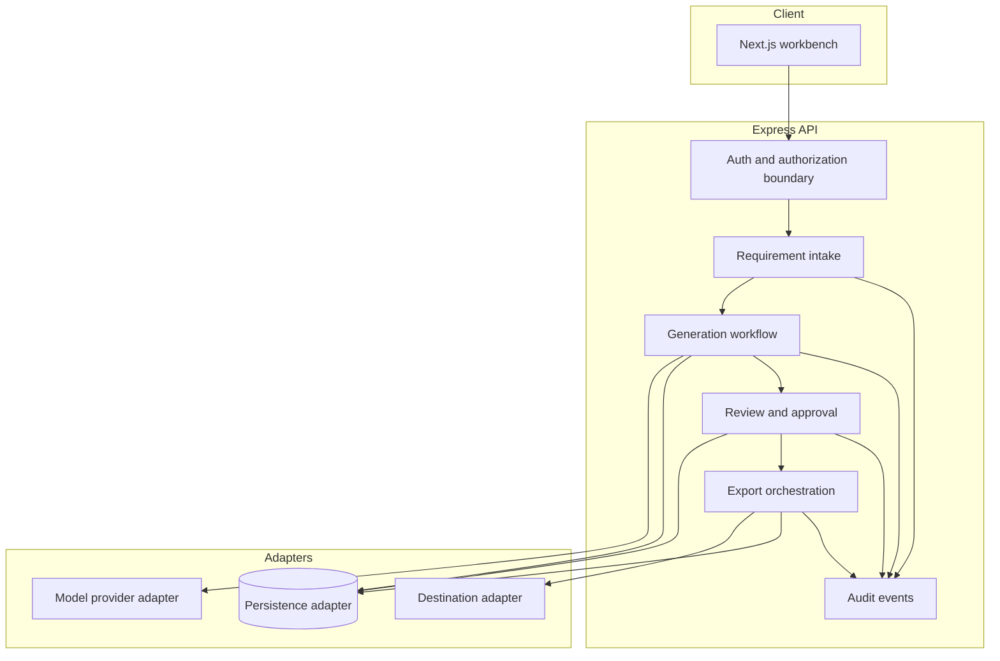

# Component Architecture

| Component | Owns | Must not own |
|---|---|---|
| Intake | Input validation, source revision, upload lifecycle if added. | Prompts or export. |
| Workflow | State progression, budgets, sequencing, errors. | Auth decisions or DB driver details. |
| Domain policy | Hierarchy and approval invariants. | HTTP, model vendor, persistence framework. |
| Model adapter | Provider credentials, request normalization, usage. | Business decisions or authorization. |
| Review | Version and decision transitions. | Trusting client `approved` flags. |
| Export adapter | Destination mapping and idempotency. | Choosing which version is approved. |
| Audit | Append event according to policy. | Raw secrets/full prompts by default. |

Start API feature files flat and minimal; add categorized directories only when ownership warrants them. Expose feature composition through `index.ts`; no consumer deep imports. Candidate folder structure is in [folder-structure.md](folder-structure.md).
