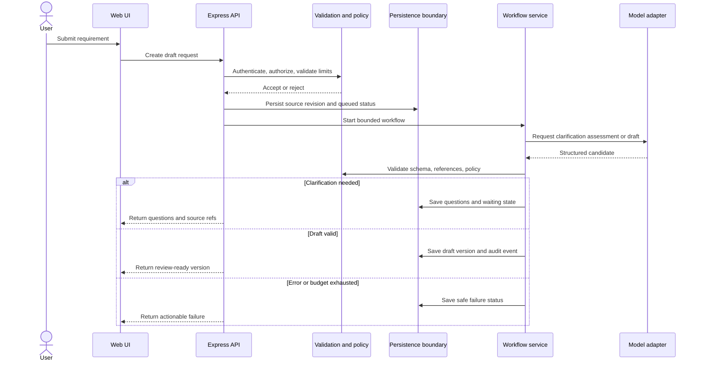
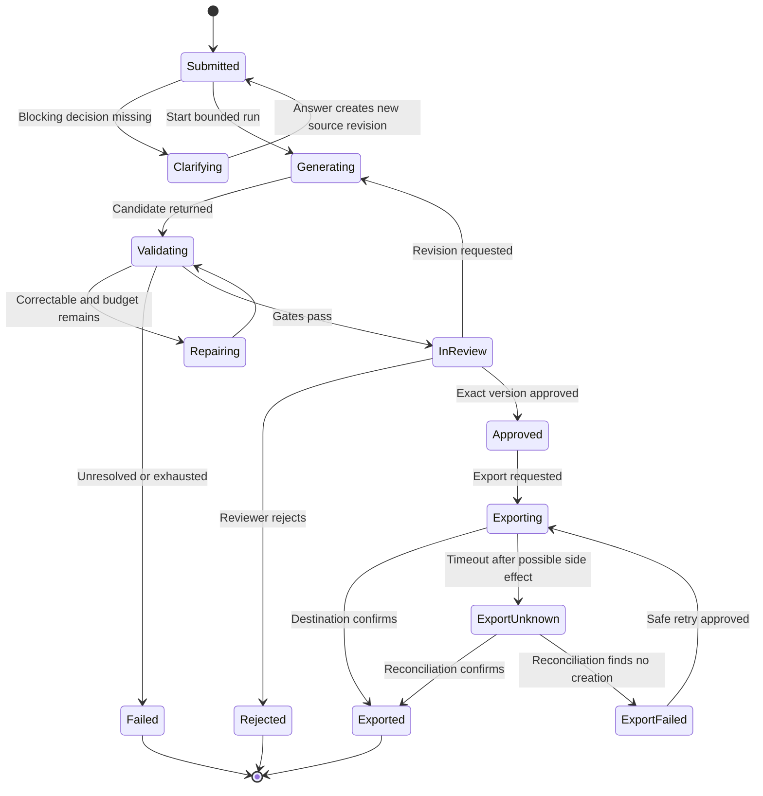

# Data Flows and State Transitions

## Generation sequence

## State machine

## System invariants

1. Every item belongs to one draft version and one source requirement.
2. Answers create a new source revision; original text is not overwritten.
3. Approval records reviewer, time, immutable version, and integrity key.
4. Edits create a new version and clear prior approval.
5. Export rechecks authorization and exact-version approval immediately before sending.
6. Unknown destination outcome is reconciled before retry.
7. State transitions record identity, cause, time, and result without secrets/prompt content.

## Error classes and retries

Classify user input, denial, provider transient/permanent, schema/policy, persistence, destination transient/permanent, and unknown side effect. Retry only transient failures with bounded backoff/jitter. Do not retry denial/invalid input or an ambiguous export without reconciliation.
