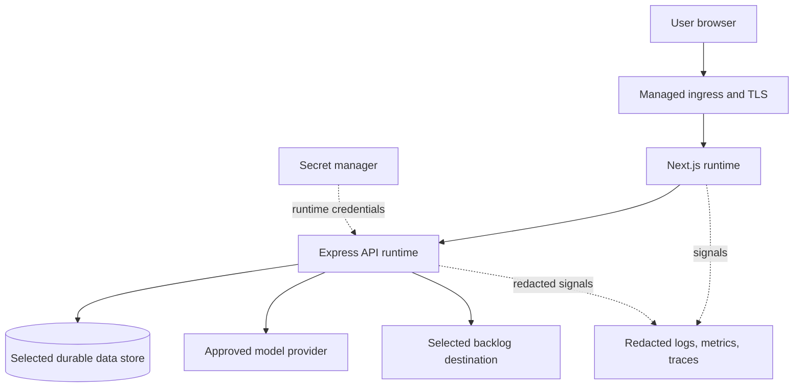

# Deployment Architecture Proposal

**Status:** Target concept only; no production environment is configured in this repository.

## Environment proposal

| Environment | Purpose | Data | Promotion |
|---|---|---|---|
| Local | Development and deterministic tests. | Synthetic only. | Developer controlled. |
| CI | Lint, typecheck, tests, scans. | Ephemeral synthetic data. | Required checks pass. |
| Staging | Provider/destination sandbox validation. | Synthetic or approved anonymized. | Release owner approval. |
| Production | Real workload. | Classified customer data under policy. | Product, security, operations gates. |

## Decisions needed

Provider/region; runtime and container; ingress/WAF; database/backup; async jobs; secrets; identity; model and destination; telemetry; CI/CD/artifact provenance; egress policy; RTO/RPO; residency; load profile; on-call. Earlier AWS/GCP, Terraform, Kubernetes/Helm, PostgreSQL/pgvector, Redis, and domains are examples, not accepted choices.

## Resilience principles

Persist status before long work. Provider outage must not lose input/drafts. Export timeout requires reconciliation. Backups need restore drills. Dependency failure should produce explicit status. If async workers are added, test graceful shutdown and in-flight recovery.
