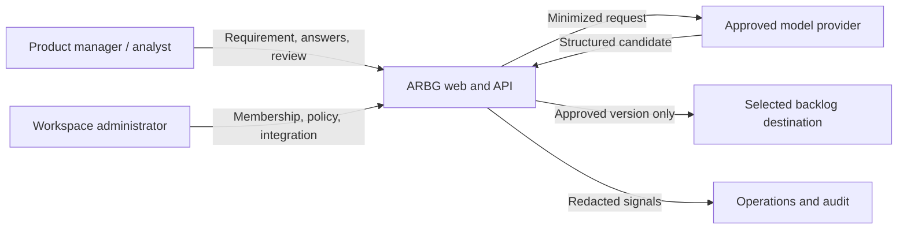

# High-Level Architecture

**Recommended proposal:** modular feature code on the existing Next.js + Express/TypeScript foundation. Model calls and external exports live behind explicit feature adapters. Start with bounded workflow steps, not self-directed general agents.

## Logical layers

| Layer | Responsibility | Boundary |
|---|---|---|
| Web workbench | Intake, progress, review, edit, approval. | Browser data is untrusted. |
| API delivery | Authentication integration, validation, HTTP, limits. | Scope every request to actor/project. |
| Application features | Workflow, versioning, review, export coordination. | Enforce transitions and budgets. |
| Domain policy | Hierarchy, traceability, approval rules. | Deterministic; no framework/vendor imports. |
| Persistence adapter | Projects, revisions, drafts, events, exports. | Tenant isolation, retention, deletion. |
| Model adapter | Provider request/response and usage normalization. | External data processor boundary. |
| Destination adapter | Mapping, idempotency, reconciliation. | External side-effect boundary. |
| Operations | Logs, metrics, secrets, deploy, recovery. | Minimize sensitive telemetry. |

## Context diagram

## Architecture rules

- Models propose; application policy makes deterministic decisions.
- Pass dependencies explicitly; feature service does not import vendor clients directly.
- Keep source documents immutable; clarification, generation, edit, and approval are versioned.
- Add durable async jobs only if latency or provider limits require them; include cancellation, retry, ownership, and recovery.
- No vector search until approved corpus, access filtering, and evaluation show value.
- Do not log prompts/source text by default.

Current API registers only health in `servers/api/bootstrap/create-app.ts`; no ARBG routes exist yet. Apply root `AGENTS.md` and `.agent/instructions/architecture.md` when implementation starts.
