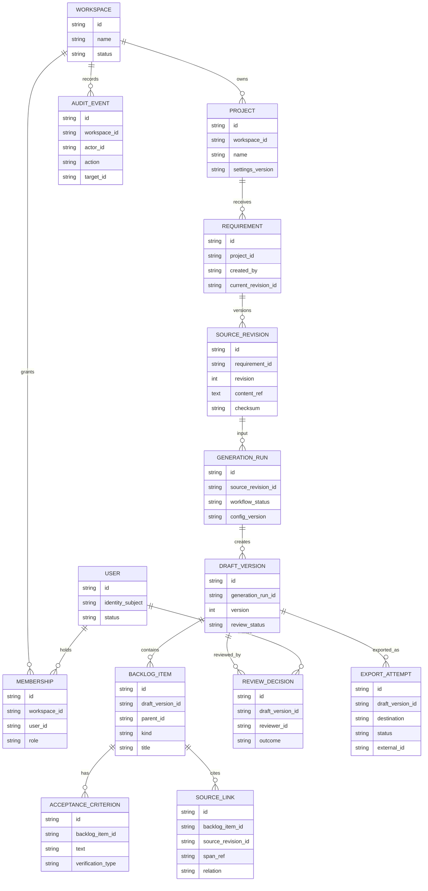
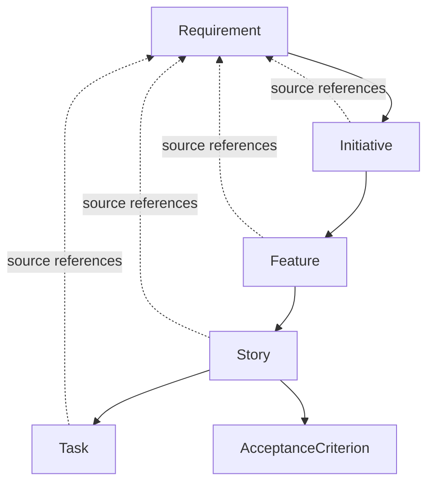

# Data Model Proposal

**Status:** Logical model only. MongoDB is currently an optional API integration; ARBG schemas/collections are not implemented. This is not a physical database decision.

## Entity relationship

## Entity rules

- Workspace is the proposed authorization boundary; define account semantics with the product owner.
- Membership binds user to workspace and role; user-supplied workspace ID is never authorization evidence.
- Source revisions are append-only. Attachments, if approved, use protected object storage plus metadata/checksum.
- Generation run records source revision and workflow/template/schema/model-config versions, not secrets.
- Draft version is immutable. Human edits produce a new version and auditable diff/change set.
- Source link points into an exact source revision and must be validated server-side.
- Review decision records actor, outcome, time, version, and reason where provided. Approval is invalid for newer version.
- Export attempt records idempotency key, destination, external ID, normalized status/error, and timestamps; never credentials.
- Audit event policy must define integrity, access, retention, redaction, and deletion exceptions before calling it immutable.

## Data classification and lifecycle

Treat user input and attachments as confidential until assessed. Decide retention by record type, user deletion, legal hold, provider retention, backup expiry, and derived-index cleanup. Encrypt transport/storage using selected platform controls. Define restore and deletion behavior before production.

## Candidate indexes

Potential access patterns: `(workspaceId, projectId, createdAt)`; unique `(requirementId, revision)`; unique `(generationRunId, version)`; `(draftVersionId, parentId)`; `(workspaceId, occurredAt)`; unique `(destinationId, idempotencyKey)`. Validate database-specific support and real query plans before migration.

## Backlog hierarchy

Not every input needs every level. Preserve parent meaning and source links when a level is omitted.
